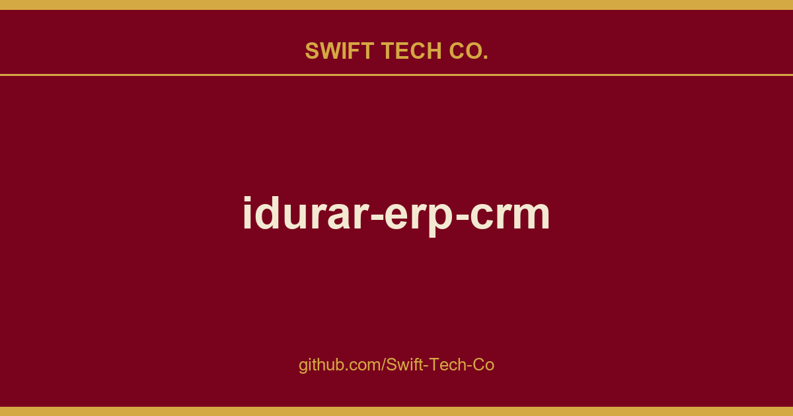

# idurar-erp-crm

## What This Is

We keep a working index for product and engineering, and idurar-erp-crm is the entry that collects our notes, examples and fixes. It reflects how Swift Tech Co. actually uses this in builds and client work.

## Images

## Sources

Compiled and maintained from upstream [idurar/idurar-erp-crm](https://github.com/idurar/idurar-erp-crm) under permissive open-source license.

---

Maintained by [Swift Tech Co.](https://github.com/Swift-Tech-Co) - [Telegram](https://t.me/+Qt_eFvkb2rliMzNh)

## Sources

Compiled and maintained from upstream [idurar/idurar-erp-crm](https://github.com/idurar/idurar-erp-crm) under permissive open-source license.

---

Maintained by [Swift Tech Co.](https://github.com/Swift-Tech-Co) - [Telegram](https://t.me/+Qt_eFvkb2rliMzNh)

## Sources

Compiled and maintained from upstream [idurar/idurar-erp-crm](https://github.com/idurar/idurar-erp-crm) under permissive open-source license.

---

Maintained by [Swift Tech Co.](https://github.com/Swift-Tech-Co) - [Telegram](https://t.me/+Qt_eFvkb2rliMzNh)